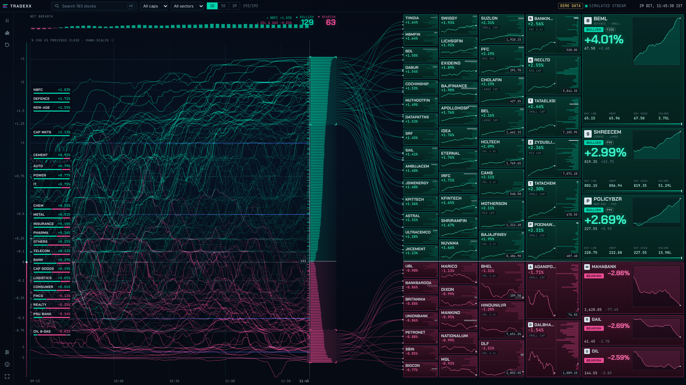

# TradeXX: breadth monitor (reconstruction)

A working, dense, dark trading dashboard that rebuilds the main interface on the upper
monitor in the reference reel (`instagram.com/reel/DfFrvCWTijy`). It has green and
magenta performance trajectories on the left, a narrow endpoint strip, curved connector
fans, and a tightly packed stock-card matrix on the right.

**It runs on simulated data only.** A visible `DEMO DATA` badge is always shown. The app
has no market connection, and nothing on screen is a quote, recommendation, or signal.



## Run

Requires Node 20+ (tested on Node 25).

```bash
npm install
npm run dev          # http://localhost:5173
```

Production build:

```bash
npm run build && npm run preview
```

A clean copy (no `node_modules`, no `dist`) was verified with `npm ci && npm run build`.

URL options give repeatable sessions and screenshots:

| Param | Default | Meaning |
|---|---|---|
| `seed` | `42` | Simulator seed. The same seed always produces the same market. |
| `start` | `11:45` | Simulated IST clock to start streaming from (09:15–15:30). |
| `period` | `1D` | `1D`, `5D` or `1M`. |
| `intro=0` | off | Skip the reveal animation. |

`npm run screenshot` saves `docs/screenshot-1920x1080.png`. It needs the dev server to be
running and Google Chrome to be installed.

## What reference material was inspected

The reel was opened in a browser. I paused the video (18.8 s, 1440×2560) and looked at
three frames at full size:

- **~1.0 s**: the chart field drawing in. It shows sector labels with values and
  breadth bars, a teal-to-magenta gradient y-axis with non-linear ticks, blue horizontal
  guides, a breadth histogram above the plot, and BULLISH/BEARISH counters. The cards
  are not on screen yet.
- **~2.2 s**: the endpoint strip. It has stacked per-instrument bars, teal above and
  magenta below, bracketed top and bottom spans, a split marker, and changing counters.
- **~4.0 s**: the card matrix. Columns get wider from left to right. It shows small
  ticker/% tiles, medium tiles with sparklines and price chips, tiles with horizontal
  profile bars, and large detail cards with a BULLISH/BEARISH badge, a big %, a mini
  chart and a stats row. The green block sits above the magenta block.

I could not capture later frames, because video playback stalled once the browser pane
was hidden. As a result, **the connector geometry and the reveal timing are built from
the brief and from the frames above. They were not measured from the footage.** The
small text in the reel can't be resolved reliably. Symbols, prices, percentages and
labels in this app are sample values and are not transcriptions. The reel's browser
shows a third-party product. This app does not use that product's name, logo or
branding.

The result has not been checked pixel by pixel against the reel. It is a reconstruction
of the composition and behaviour.

## Layout and reconstruction choices

| Area | Choice |
|---|---|
| Proportions | Field 44%, strip 4%, corridor 10%, matrix 42% (`src/view/layout.ts`). Scales with `min(W/1860, H/1010)`, multiplied by the density setting. |
| Y-axis | **Rank-quantile scale.** Each instrument's latest value lands on its own evenly spaced row, so trajectory endpoints line up with the strip rows. The zero line then splits the field in proportion to advancers and decliners, which matches the reel, where the strip split and the chart zero coincide. The axis is non-linear, and tick labels show true % values. This is stated in the axis caption tooltip. |
| % change | `100 × (last − ref) / ref`. `ref` is the previous close for 1D, or the close before the window for 5D/1M. A zero, negative, missing or non-finite ref gives `null`, and the row is excluded and counted as invalid. |
| Trajectories | Canvas with additive blending, 0.65–1.15 px strokes. Opacity rises with rank extremity. Color comes from the final sign. |
| Endpoint strip | One bar per instrument in rank order. Length is √(\|%\| / max\|%\|). Brackets mark the ranks that have cards. |
| Connectors | Cubic Béziers from an instrument's strip row to its card. Width is constant and does **not** encode capital or order flow. |
| Cards | Explicit absolute layout, computed so connectors can target exact card centres. Five columns (xs → xl). The strongest movers get the largest cards on the far right. The upper block holds gainers and the lower block holds losers, and the split follows the chart's zero row. |
| Card stability | Values update on every tick. Which stock sits in which slot is re-ranked every 20 s by default (10 s, 60 s or manual in Settings), plus on filter, period or size changes. |
| Profile bars | **Simulated** volume-at-price from today's simulated 1-minute bars. No order book is implied. |
| Tags | `VOL n×` is today's volume ÷ expected volume by this time of day. `P97` is the percentile rank of % change. The reel's "LONG/SHORT BUILD-UP" tags need open-interest data, so they were replaced with defined metrics. |
| Large-card stats | Day low, VWAP, day high and volume, all computed from bars. The reel's "support/resistance" fields have no defined source here. |
| Histogram | Net breadth over time: the number of instruments above their reference minus the number below. |
| Counters | Bullish = pct > 0 and bearish = pct < 0 in the current filtered universe. Unchanged and invalid rows are listed in the counter tooltip. |
| Fonts | Chakra Petch (tickers), JetBrains Mono (numbers), Inter (labels). All are bundled through `@fontsource`, so they work offline. |

### Reveal sequence

0–0.5 s: grid and labels. 0.5–2.5 s: trajectories wipe in from left to right.
1.8–3.0 s: the strip fills. 2.6–4.2 s: connectors draw. 3.3–5.5 s: cards stagger in,
starting with the columns nearest the corridor. After that, ticks arrive every 1.5 s.
The chart and strip tween for about 650 ms per tick, connectors morph through a CSS `d`
transition, and changed cards flash briefly. The intro runs once on load. The rail's
replay button runs it again, and normal navigation never does. Reduced motion follows
the OS setting or the Settings drawer, and turns off the intro, tweens and flashes.

## Controls (each one is functional)

- **Search** (⌘K / Ctrl K) by symbol or sector. Enter opens the detail drawer on an exact match.
- **Universe** (all, large, mid, small cap; demo tiering) and **Sector** selects. Clicking a sector label on the chart toggles that sector filter.
- **Period**: 1D, 5D or 1M.
- **Hover** a trajectory, strip row, connector or card. The other three highlight together and everything else dims. The chart tooltip shows the value at the cursor time.
- **Click** any of them to open the detail drawer. It shows a larger chart with reference and VWAP lines, 1-minute volume, stats and the volume-at-price profile. It reads the same row object as the card, so the last values always agree.
- **Rail**: pause/resume the stream, re-rank cards now, replay the intro, open Settings (density, motion, re-rank cadence) or About, and toggle fullscreen.
- Below 900 px wide, the desktop composition stays intact and scrolls horizontally. A Field/Board toggle jumps between the chart and the cards.

## Verified

Checked in a browser at 1920×1080, 2560×1440 and 375×812:

- The card price/% and the detail-drawer price/% match across several ticks.
- Sector filter (IT), search (BANK), a search with no matches, and tier filter: cards, connectors, counters, sector labels and the `shown` count all change together. The no-match case shows an empty state with a clear-filters button.
- Bullish + bearish + unchanged = number of filtered rows.
- Pause freezes the simulated clock and the status reads `PAUSED`. Resume continues from where it stopped.
- 5D and 1M switch the reference label (for example "vs close of 22 Oct") and the date ticks.
- Reveal order was checked through the Web Animations API: connectors were drawing and cards had not started at t = 3.0 s.
- Performance (dev build, 1920×1080, 193 trajectories, 62 cards): median frame time 16.7 ms and p95 17.7 ms during updates, with about one 50–60 ms task per 1.5 s tick (the React render of the board).

## Project structure

```
src/data/      types, adapter contract, demo simulator, store, tick→bar aggregation, calculations
src/view/      view-model derivation, rank-quantile scale, layout geometry, theme tokens, formatting
src/components FieldCanvas (canvas), FieldOverlay (SVG/HTML), Connectors, CardMatrix/Card,
               Header, Rail, DetailDrawer, SettingsDrawer
```

Data flows one way: **adapter → `MarketStore` (single source of truth) → `derive()`
view-model → every view.** Rendering, layout, adaptation and financial calculations live
in separate modules. Instrument IDs (`NSE:SYMBOL`) are stable.

## Replacing the demo adapter with a real market-data source

1. Implement `MarketDataAdapter` from `src/data/adapter.ts`:

   ```ts
   class MyFeedAdapter implements MarketDataAdapter {
     readonly source = 'LIVE' as const;
     async load(): Promise<InitialLoad> {
       // GET /api/universe and /api/history from YOUR backend.
       // Return instruments, session times, and per-instrument series:
       // prevClose, history (15-min bars of prior sessions), today (1-min bars), avgDayVolume.
     }
     subscribe({ onTicks, onStatus }) {
       const ws = new WebSocket('wss://your-backend.example/stream'); // your own proxy
       ws.onopen = () => onStatus('live');            // or 'delayed' for delayed entitlements
       ws.onmessage = (m) => onTicks(JSON.parse(m.data)); // Tick[]: { id, ts, price, volume }
       ws.onclose = () => onStatus('disconnected');
       return () => ws.close();
     }
   }
   ```

2. Swap it in where the store is created in `src/App.tsx`:
   `new MarketStore(new MyFeedAdapter())`.

3. **Keep provider credentials on the server.** The browser adapter should only talk to
   your own backend or WebSocket proxy, which holds the API keys and enforces
   entitlements. Never put keys in `VITE_*` variables, because those get bundled.

4. Status handling is already in place. `MarketStore` marks the feed `stale` after 6 s
   without ticks while streaming, and the header shows `LIVE`, `DELAYED`, `STALE`,
   `DISCONNECTED`, `PAUSED` or `SESSION CLOSED`. The `DEMO DATA` badge is tied to
   `source === 'DEMO'`. If you add a live adapter, render the badge conditionally on
   `snapshot.source` in `Header.tsx`.

5. Data hygiene is enforced in `applyTick`. Ticks with prices ≤ 0 or non-finite are
   dropped, as are out-of-order ticks. `percentChange` returns `null` instead of
   inventing a value. Make sure the `id`s your feed sends match the instrument IDs.

## Known limitations

- Demo symbols are real NSE tickers, but their **price levels are random**, so they will
  not match real quotes. The demo calendar skips weekends and ignores exchange holidays.
- Safari does not support CSS `d` transitions, so connectors jump to their new position
  there instead of morphing.
- `oxlint` reports advisory React-hooks warnings for intentional patterns, such as refs
  that feed the canvas loop. There are no errors.
